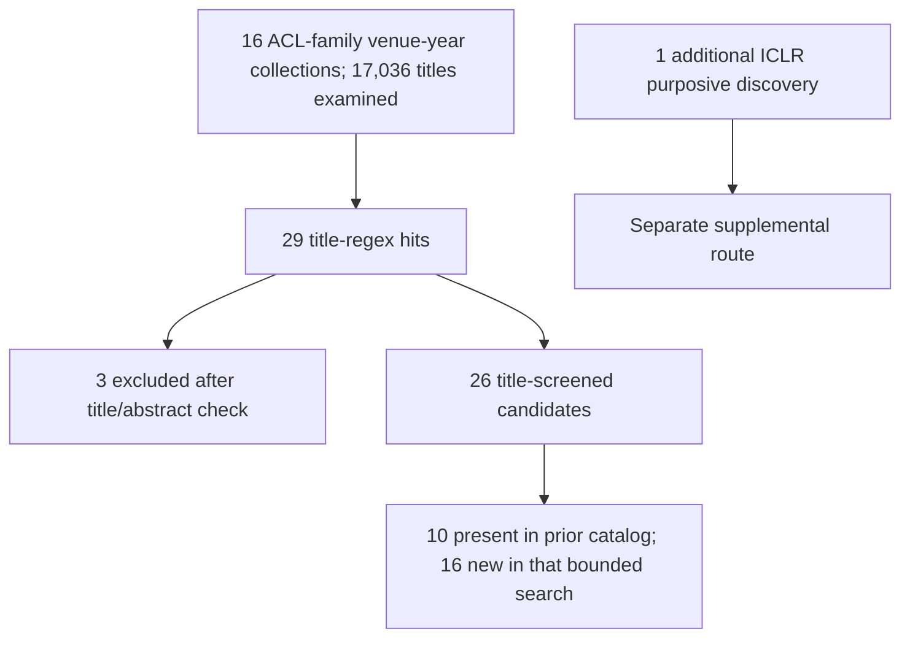

# PRISMA 2020 compliance audit: evidence-based status and manuscript boundaries

**Systematic review title:** Agreeing for the Right Reasons: A Survey of Sycophancy, Apology, and Acknowledgement in Language, Vision-Language, and Multi-Agent Models  
**Date:** 2026-11-21. **Status:** *Incomplete systematic review; fully specified current limitations.* This report is not an assertion that a completed PRISMA study has been conducted. It is more accurate than publishing attractive but fictitious counts.

## 1. Rationale and explicit questions

The problem is **whether an interactive model agrees or corrects for evidentially justified reasons**, not whether it always stands firm or always agrees. Compare three response families: (i) sycophancy and unwarranted conformity; (ii) apology and responsibility attribution; (iii) acknowledgement and evidence-sensitive revision. Analyze text-only, vision/video, and multi-agent settings.

RQ1. When do models maintain an initially correct answer under misleading feedback versus reverse an initially incorrect answer under valid evidence?  
RQ2. Which observable acts (agreement, validation, acknowledgement, apology, responsibility attribution, explanation) predict correct/incorrect epistemic change, and which are only polite expressions?  
RQ3. How do modalities, peer identities, information asymmetry, evidence quality and number of dialogue/debate turns affect correctness?  
RQ4. Do interventions reduce unwarranted conformity **without** suppressing justified updates?  
RQ5. Which experiments have interpretable causal comparators, grounded outcomes, transparent measurements and human consequences?

## 2. Predefined eligibility criteria

**Eligible primary evidence:** final official peer-reviewed proceedings of ACL/EMNLP/NAACL/EACL main tracks; ICLR, ICML, NeurIPS main; CHI, CVPR, ICCV, ECCV, COLM main; NeurIPS archival Datasets & Benchmarks if separately declared. Work must operationalize *at least one*: pressure-versus-correctness, evidence-dependent correction, apology/acknowledgement in feedback handling, visually contradicted answer, majority/agent-identity influence, or argument-responsive revisions; or an explicitly tested mitigation with relevant behavioral outcomes. Include empirical or substantive theoretical analyses with explicit link to the operational construct. Years 2022–2026, with older foundational papers individually documented.

**Exclusion:** duplicate version; preprint-only; withdrawn/unaccepted; conference workshop; ACL Findings (even when peer reviewed, since strict main policy); journal publication (context allowed); secondary survey; position paper without original relevant result; generic model accuracy or generic "debate" without meaningful evidence/pressure process measurements; non-LLM multi-agent systems; generic hallucination without influential challenge. **Excluded does not mean unimportant.** Maintain a contextual bibliography separate from quantitative eligibility.

**Selection:** publisher track and official version first; title/abstract relevance second; full-text eligibility third; design quality fourth. No conference quotas, citation-count thresholds or outcome-significance filters. **Prioritization is not PRISMA eligibility.**

## 3. Record/duplicate/quality methods

**Identification:** execute and archive database-specific search queries; do not use a Google-style rank-sorted web list as a numeric source. [Search provenance](PRISMA-search-provenance.md).

**Deduplication:** primary DOI, official venue ID, normalized title+year, and manual version matching. One study may have multiple reports; retain published version and preserve link to other reports. Report per-source raw records and duplicate groups.

**Title/abstract screening:** screen all identified records, recording reviewer identity, date, inclusion/exclusion and primary reason; borderline papers continue to full text. This repository currently shows an earlier single-assistant, ACL-only title screening and a later targeted publisher shortlist. It has **not** established comprehensive cross-venue screening.

**Full-text screening:** verify methods, outcomes, applicable track, versions, correctness labels and comparator. Record sought, retrieved, not retrievable, excluded with reason, and final included studies; those records are currently absent. **No final full-text inclusion decision can be asserted for the entire 34-candidate collection.** A [targeted publisher-PDF extraction for four NeurIPS main-track studies](NeurIPS-full-text-evidence.md) now documents source methods, outcome types, and critical limits. It is single-reviewer and does not retroactively supply database-wide full-text screening or adjudication.

**Data extraction:** independently record original answer and its ground truth, challenge type/validity and supporting evidence, final answer and its truth value, agreement/acknowledgement/apology acts, confidence, user/peer identity, visual grounding, debate protocol, model/sampling/prompt, sample size, baselines, effect estimates and uncertainty, human outcome and study limitations.

**Risk-of-bias and study quality (planned, not scored):** use six 0–2 rubric elements: construct match, independent pressure/evidence manipulation, outcome-ground-truth validity, baseline controls, evaluation transparency, and reproducibility. Record who scored each and disagreement resolution. Distinguish *internal validity* from *relevance tier*. Do not claim GRADE certainty without applying a suitable formal framework.

## 4. PRISMA 2020 flow — what can actually be reported

**A. Historical, bounded ACL title search**, from [existing recorded research](survey-search.md):

This is a reproducible *partial search subflow*, **not** a study-level PRISMA 2020 diagram. The earlier 17,036 count is the universe of title records checked, not a cross-database count of relevant reports identified.

**B. Combined, actual PRISMA flow (required for final systematic manuscript):**

| PRISMA 2020 identification-to-inclusion item | Value | Why |
|---|---|---|
| Records identified through databases/registers | **Not established** | No complete source exports or per-database identification log |
| Records identified through citation/other sources | **Not established** | Purposive searches, but no fully enumerated source ledger |
| Duplicates removed | **Not established** | Only targeted candidate-level checking, not database-wide |
| Records screened | **Not established** | Cannot reuse historical 29 as cross-venue screen |
| Records excluded at screening | **Not established** | Complete title/abstract ledger missing |
| Full-text reports sought | **Not established** | Candidates are publisher-linked, not retrieval log |
| Reports not retrievable | **Not established** | No complete retrieval log |
| Full texts excluded (with primary reasons) | **Not established** | No full-text exclusion ledger |
| Studies and reports included | **Not established** | 34 reading candidates are NOT 34 final inclusions |

**No valid combined diagram can be populated numerically without the missing raw data.** Guessing counts would violate the purpose of PRISMA.

## 5. PRISMA 2020 27-item checklist audit

*Reported* means a factual section is available; *partial* means the information is insufficient to claim the review stage completed; *not done* means no supporting evidence was captured. Missingness is explicit instead of being represented by 0.

| Item | Status | Documentation/constraint |
|---|---|---|
| 1 Title | Partial | Survey title provided; do not claim "systematic review" until one exists |
| 2 Abstract | Not done | Manuscript abstract not supplied or audited |
| 3 Rationale | Reported | User's introduction explains evidence-vs-pressure distinction |
| 4 Objectives | Reported | Five RQs above |
| 5 Eligibility criteria | Reported | Section 2; strict main-track boundary |
| 6 Information sources | Partial | Search provenance lists observed publisher sources; complete database exports absent |
| 7 Search strategy | Partial | Exact prior ACL regex and executed targeted queries exist; no full database-specific search strings |
| 8 Selection process | Partial | Earlier single-assistant title screen; no cross-venue full screening / adjudication |
| 9 Data collection process | Not done | Targeted PDF extraction completed for four NeurIPS main-track papers; not all 34 |
| 10 Data items | Reported as definitions | Variables listed in section 3; no completed extraction |
| 11 Study risk-of-bias assessment | Not done | Rubric specified but not administered |
| 12 Effect measures | Partial | Proposed flip rates and human outcomes; paper-specific estimates absent |
| 13a–f Synthesis methods | Partial | Narrative grouping and non-pooling rules; no formal study-level synthesis |
| 14 Reporting-bias methods | Not done | No assessment of missing results |
| 15 Certainty-assessment methods | Not done | No formal certainty framework applied |
| 16a Study-selection results | Partial | Historical bounded ACL counts; no combined PRISMA counts |
| 16b Excluded-study citations | Partial | Representative explicit exclusion decisions in [core](../literature/prisma-core-papers.md) |
| 17 Study characteristics | Partial | Publisher-linked abstract-level descriptions; models, samples and designs not all extracted |
| 18 Risk of bias in studies | Not done | No full-text appraisals |
| 19 Individual study results | Partial | Narrative publisher abstract summaries; no systematic effect estimates/CI |
| 20a–d Synthesis results | Not done | Four source-checked NeurIPS full-text method/outcome comparisons; no complete included sample or harmonized effect-size synthesis |
| 21 Reporting-bias assessments | Not done | Unavailable |
| 22 Certainty of evidence | Not done | Unavailable |
| 23a–d Discussion | Partial | Tradeoffs, limitations and implications in [synthesis](evidence-synthesis.md) |
| 24a–c Registration/protocol/amendments | Partial | Protocol recorded in repo, not prospectively registered; retrospective amendments visible in Git history |
| 25 Support | Not supplied | Funding and role of funders not provided |
| 26 Competing interests | Not supplied | Author declarations not provided |
| 27 Availability of data/code/materials | Partial | Repo and source links public; no complete screening export, extraction dataset or analysis scripts |

## 6. Synthesis and reporting boundaries

- **Do not compute a cross-paper average sycophancy rate** from incompatible tasks, denominators, model versions, or judgments. For objective tasks, report the full 2x2: initially correct/incorrect × finally correct/incorrect, crossed with warranted/false evidence whenever possible.
- **Never equate apology with surrender:** e.g., [Alnasser et al. (EMNLP 2026)](https://aclanthology.org/2026.emnlp-main.1595/) report apology and retention co-occurrence; they operationalize distinct dimensions.
- **Do not equate consensus with truth:** NeurIPS 2024 and 2025 debate works separate majority, interaction, and correctness.
- **VLM grounding** should compare image/video observation before and after text pressure; anti-sycophancy tuning must also test uptake of correct corrections.
- **Human trust ≠ long-run retention.** Do not generalize immediate experimental preference to continued use.
- **Mixed evidence types:** publish narrative synthesis with clear separate columns for direct behavior, theory, interventions and human evaluations rather than pool effects without compatible denominators.

## 7. Progress audited in this PR

- [Record-level source verification for all 34 candidate items](publisher-verification-ledger.md) now distinguishes 32 directly accessible publisher pages from two CHI records corroborated by ACM indexing and DBLP. **This completes metadata verification of this known candidate set, not PRISMA identification of all relevant studies.**

- [Source-checked PDF methods and outcomes for four NeurIPS main-track studies](NeurIPS-full-text-evidence.md) are now recorded, with critical comparability limits.
- [Automated bibliography-integrity validator](validate_review.py) checks candidate count, DOI/proceedings domains, unique publication links, section totals and explicit noncompletion language. Validation does **not** establish scientific completeness.
- These are real advances within the documented candidate set, not grounds for certifying missing independent screening, venue-wide exports, or systematic risk-of-bias.

## 8. Readiness decision

**This is not a completed PRISMA review.** The repository now has documented objectives, criteria, an improved cross-venue publisher-linked candidate set, actual search provenance, a traceable partial ACL subflow, and an itemized compliance audit. The still-unobserved search, duplicate, full-text and appraisal results cannot responsibly be marked "complete" without performing and documenting them.

**Review status:** Keep the GitHub changes as a **draft PR**, not a claimed PRISMA-compliant manuscript submission. The audit itself has no unspecified placeholder numbers: every unavailable value is explicitly *not established*.
