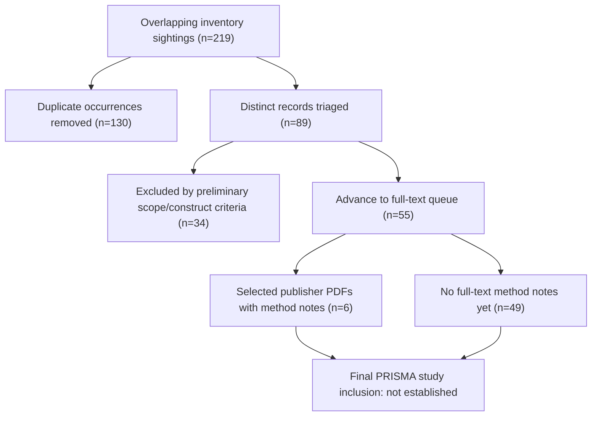

# Executed screening of an explicitly bounded repository-derived corpus

**Snapshot:** 2026-11-21 (date of seed lists and targeted discovery); reconciled in this PR. **Audit unit:** report-level title/proceedings record, not a unique model, benchmark experiment or human subject. **Screened by:** one assistant using the repository's publication metadata, prior study summaries and targeted official publisher checks. **This is a real, reconstructable *bounded corpus reconciliation*, NOT a complete multi-database systematic search or a final PRISMA 2020 inclusion flow.**

## Identification and deduplication — observed counts

| Known input inventory | Occurrences read | Source file / route |
|---|---:|---|
| Original curated inventory | 52 | [initial-catalog.csv](initial-catalog.csv) |
| Historical ACL screened ledger (29 regex hits + 1 ICLR supplementary) | 30 | [screening.csv](screening.csv) |
| Earlier priority conference list | 31 | [older core manifest](../papers/core-conference-manifest.csv) |
| General current reading list | 69 | [repository README](../README.md) |
| Prior published-conference evidence map | 34 | [34-paper candidate map](../literature/prisma-core-papers.md) |
| Newly found publisher records: 2 CVPR 2025 + 1 ICML 2026 | 3 | [targeted official source list](additional-verified-papers.md) |
| **Total overlapping catalog sightings** | **219** | Not independent database query hits |
| **Removed duplicate sightings based on normalized title** | **130** | Repeated entries across the six inventories |
| **Unique candidate report records after deduplication** | **89** | [Machine-readable individual decisions](repository-screening-snapshot-2026-11-21.jsonl) |

**Important:** These are six overlapping *curated inventories*. Counting their 219 sightings as “records identified from six bibliographic databases” would be false. The earlier 17,036/29 ACL title-search counts belong solely to a separate bounded metadata experiment, and are not added here. This exercise demonstrates transparent deduplication of the **known** reading corpus; it does not establish that all relevant conference papers were found.

## Executed metadata/previous-synopsis screening — observed results

| Stage | Count | Meaning |
|---|---:|---|
| Unique records available for single-assistant publication/title/concept triage | **89** | Publisher URL, existing notes, conference-track checks where available |
| Excluded at this preliminary eligibility stage | **34** | See individual decisions below |
| **Advanced to full-text eligibility queue** | **55** | **54 main-conference** candidates + **1 NeurIPS archival D&B** candidate |
| Of advanced candidates, selected official PDFs previously inspected for method/outcome details | **6** | Four NeurIPS + two CVPR; purposively checked, not comprehensive |
| Advanced candidates without documented full-text method inspection | **49** | Not full-text screened |
| **Final included studies according to a complete PRISMA review** | **Not established** | Requires full conference-wide database records, retrieval/exclusion log and adjudicated eligibility |

The exact 34 exclusion reasons are recorded **per title**. Labels `advance_fulltext` and `excluded_metadata_screen` are decisions **within this explicitly known candidate universe**. No paper advanced on the basis of being highly cited or from a preselected venue quota.

## Evidence flow for this bounded catalog reconciliation only

**This is NOT a PRISMA 2020 study-selection flow diagram** and must not be pasted into a manuscript as one. It is a *repository-bounded audit with a partial flow*, not a prospective systematic search. Only the executed phases have numbers.

## Preliminary included-for-full-text studies (55)

Main-track papers may still be rejected after full-text checking. Every record below represents an *advance-to-full-text* decision, not final eligibility.

| Publication | Preliminary stratum | Scope rationale |
|---|---|---|
| [A Diagnostic Study of Multi-Agent LLMs for Real-World Debates](https://proceedings.mlr.press/v306/pitre26a.html) | main conference candidate | Previously curated, explicit agreement/evidence mechanism; full text not yet systematically evaluated |
| [Accommodation and Epistemic Vigilance: A Pragmatic Account of Why LLMs Fail to Challenge Harmful Beliefs](https://aclanthology.org/2026.acl-long.736/) | main conference candidate | Published, directly relevant behavior, intervention or grounding study; full text not yet systematically evaluated |
| [Advancing Oversight Reasoning across Languages for Audit Sycophantic Behaviour via X-Agent](https://aclanthology.org/2025.emnlp-main.654/) | main conference candidate | Published, directly relevant behavior, intervention or grounding study; full text not yet systematically evaluated |
| [Affective Context Amplifies Sycophancy in LLM Responses](https://aclanthology.org/2026.emnlp-main.1184/) | main conference candidate | Previously curated, explicit agreement/evidence mechanism; full text not yet systematically evaluated |
| [Ask Again, Then Fail: Large Language Models’ Vacillations in Judgment](https://aclanthology.org/2024.acl-long.577/) | main conference candidate | Previously curated, explicit agreement/evidence mechanism; full text not yet systematically evaluated |
| [BrokenMath: A Benchmark for Sycophancy in Theorem Proving with LLMs](https://proceedings.mlr.press/v306/petrov26a.html) | main conference candidate | Previously curated, explicit agreement/evidence mechanism; full text not yet systematically evaluated |
| [Causally Motivated Sycophancy Mitigation for Large Language Models](https://proceedings.iclr.cc/paper_files/paper/2025/hash/a52b0d191b619477cc798d544f4f0e4b-Abstract-Conference.html) | main conference candidate | Previously curated, explicit agreement/evidence mechanism; full text not yet systematically evaluated |
| [Conformity in Large Language Models](https://aclanthology.org/2025.acl-long.195/) | main conference candidate | Previously curated, explicit agreement/evidence mechanism; full text not yet systematically evaluated |
| [Debate or Vote: Which Yields Better Decisions in Multi-Agent Large Language Models?](https://proceedings.neurips.cc/paper_files/paper/2025/hash/934252acd87f254d5d4672fbde283bd2-Abstract-Conference.html) | main conference candidate | Previously curated, explicit agreement/evidence mechanism; publisher PDF method note exists |
| [Debate-aware Learning Makes LLMs Genuine Debaters](https://aclanthology.org/2026.emnlp-main.1907/) | main conference candidate | Previously curated, explicit agreement/evidence mechanism; full text not yet systematically evaluated |
| [DeceptionBench: A Comprehensive Benchmark for AI Deception Behaviors in Real-world Scenarios](https://proceedings.neurips.cc/paper_files/paper/2025/hash/55494d8756b72c2219027edc9de1ee5a-Abstract-Datasets_and_Benchmarks_Track.html) | archival DnB candidate | Previously curated, explicit agreement/evidence mechanism; full text not yet systematically evaluated |
| [Decomposing LLM Advice Sycophancy: Content, Style, and Framing Drive Distinct Response Dimensions](https://aclanthology.org/2026.aacl-long.12/) | main conference candidate | Published, directly relevant behavior, intervention or grounding study; full text not yet systematically evaluated |
| [Do as We Do, Not as You Think: the Conformity of Large Language Models](https://proceedings.iclr.cc/paper_files/paper/2025/hash/1da9ca7e9cef4b1af63913f05d1630a4-Abstract-Conference.html) | main conference candidate | Previously curated, explicit agreement/evidence mechanism; full text not yet systematically evaluated |
| [ELEPHANT: Measuring and Understanding Social Sycophancy in LLMs](https://proceedings.iclr.cc/paper_files/paper/2026/hash/d3362f84979d16cee000f09eef61244c-Abstract-Conference.html) | main conference candidate | Previously curated, explicit agreement/evidence mechanism; full text not yet systematically evaluated |
| [Exploring Response Uncertainty in MLLMs: An Empirical Evaluation under Misleading Scenarios](https://aclanthology.org/2025.emnlp-main.916/) | main conference candidate | Previously curated, explicit agreement/evidence mechanism; full text not yet systematically evaluated |
| [Feeling Right vs. Being Right: How AI Sycophancy Affects Value-Laden Deliberation](https://aclanthology.org/2026.acl-long.2046/) | main conference candidate | Published, directly relevant behavior, intervention or grounding study; full text not yet systematically evaluated |
| [Flattery in Motion: Benchmarking and Analyzing Sycophancy in Video-LLMs](https://aclanthology.org/2026.acl-long.369/) | main conference candidate | Previously curated, explicit agreement/evidence mechanism; full text not yet systematically evaluated |
| [From Yes-Men to Truth-Tellers: Addressing Sycophancy in Large Language Models with Pinpoint Tuning](https://proceedings.mlr.press/v235/chen24u.html) | main conference candidate | Previously curated, explicit agreement/evidence mechanism; full text not yet systematically evaluated |
| [Good Arguments Against the People Pleasers: How Reasoning Mitigates (Yet Masks) LLM Sycophancy](https://aclanthology.org/2026.acl-long.1126/) | main conference candidate | Published, directly relevant behavior, intervention or grounding study; full text not yet systematically evaluated |
| [Grounding Gaps in Language Model Generations](https://aclanthology.org/2024.naacl-long.348/) | main conference candidate | Previously curated, explicit agreement/evidence mechanism; full text not yet systematically evaluated |
| [Have the VLMs Lost Confidence? A Study of Sycophancy in VLMs](https://proceedings.iclr.cc/paper_files/paper/2025/hash/07be1a0850e58ca29e2b6ce31fc0c791-Abstract-Conference.html) | main conference candidate | Previously curated, explicit agreement/evidence mechanism; full text not yet systematically evaluated |
| [How AI Models Manage Epistemic Authority: A Taxonomy and Comparative Analysis of Responses to User Disagreement](https://aclanthology.org/2026.emnlp-main.1595/) | main conference candidate | Previously curated, explicit agreement/evidence mechanism; full text not yet systematically evaluated |
| [How Identity and Opinion Shape Political Sycophancy in LLMs](https://aclanthology.org/2026.emnlp-main.1500/) | main conference candidate | Published, directly relevant behavior, intervention or grounding study; full text not yet systematically evaluated |
| [How RLHF Amplifies Sycophancy](https://proceedings.mlr.press/v306/shapira26a.html) | main conference candidate | Previously curated, explicit agreement/evidence mechanism; full text not yet systematically evaluated |
| [Improving Factuality and Reasoning in Language Models through Multiagent Debate](https://proceedings.mlr.press/v235/du24e.html) | main conference candidate | Previously curated, explicit agreement/evidence mechanism; full text not yet systematically evaluated |
| [Interaction Context Often Increases Sycophancy in LLMs](https://doi.org/10.1145/3772318.3791915) | main conference candidate | Previously curated, explicit agreement/evidence mechanism; full text not yet systematically evaluated |
| [Invisible Saboteurs: Sycophantic LLMs Mislead Novices in Problem-Solving Tasks](https://doi.org/10.1145/3772318.3791365) | main conference candidate | Previously curated, explicit agreement/evidence mechanism; full text not yet systematically evaluated |
| [Learning Multilingual Agentic Policy to Control Sycophancy](https://aclanthology.org/2026.eacl-long.169/) | main conference candidate | Published, directly relevant behavior, intervention or grounding study; full text not yet systematically evaluated |
| [Mechanisms of Prompt-Induced Hallucination in Vision–Language Models](https://aclanthology.org/2026.acl-long.1941/) | main conference candidate | Published, directly relevant behavior, intervention or grounding study; full text not yet systematically evaluated |
| [Multi-Agent Debate for LLM Judges with Adaptive Stability Detection](https://proceedings.neurips.cc/paper_files/paper/2025/hash/42475c537936b2394b5015e871765056-Abstract-Conference.html) | main conference candidate | Previously curated, explicit agreement/evidence mechanism; publisher PDF method note exists |
| [Multi-LLM Debate: Framework, Principals, and Interventions](https://proceedings.neurips.cc/paper_files/paper/2024/hash/32e07a110c6c6acf1afbf2bf82b614ad-Abstract-Conference.html) | main conference candidate | Previously curated, explicit agreement/evidence mechanism; publisher PDF method note exists |
| [Narrative License and Model Sycophancy in LLM Summaries of Scientific Work](https://aclanthology.org/2026.acl-long.746/) | main conference candidate | Published, directly relevant behavior, intervention or grounding study; full text not yet systematically evaluated |
| [No Matter Who You Are: Addressivity and Sycophancy in Large Language Models](https://aclanthology.org/2026.emnlp-main.2636/) | main conference candidate | Published, directly relevant behavior, intervention or grounding study; full text not yet systematically evaluated |
| [On scalable oversight with weak LLMs judging strong LLMs](https://proceedings.neurips.cc/paper_files/paper/2024/hash/899511e37a8e01e1bd6f6f1d377cc250-Abstract-Conference.html) | main conference candidate | Previously curated, explicit agreement/evidence mechanism; publisher PDF method note exists |
| [PersistBench: When Should Long-Term Memories Be Forgotten by LLMs?](https://proceedings.mlr.press/v306/pulipaka26a.html) | main conference candidate | Previously curated, explicit agreement/evidence mechanism; full text not yet systematically evaluated |
| [Pointing to a Llama and Call it a Camel: On the Sycophancy of Multimodal Large Language Models](https://aclanthology.org/2025.emnlp-main.1020/) | main conference candidate | Previously curated, explicit agreement/evidence mechanism; full text not yet systematically evaluated |
| [PVFH-Bench: Benchmarking Premise-Induced Visual Fixation Hallucinations in Vision-Language Models](https://aclanthology.org/2026.emnlp-main.251/) | main conference candidate | Published, directly relevant behavior, intervention or grounding study; full text not yet systematically evaluated |
| [Real-Time Monitoring and Calibration of Chain-of-Thought Sycophancy in Large Reasoning Models](https://proceedings.mlr.press/v306/hu26bb.html) | main conference candidate | Previously curated, explicit agreement/evidence mechanism; full text not yet systematically evaluated |
| [SaFeRDialogues: Taking Feedback Gracefully after Conversational Safety Failures](https://aclanthology.org/2022.acl-long.447/) | main conference candidate | Previously curated, explicit agreement/evidence mechanism; full text not yet systematically evaluated |
| [Self-Augmented Preference Alignment for Sycophancy Reduction in LLMs](https://aclanthology.org/2025.emnlp-main.625/) | main conference candidate | Published, directly relevant behavior, intervention or grounding study; full text not yet systematically evaluated |
| [Sycophancy Hides Linearly in the Attention Heads](https://aclanthology.org/2026.eacl-long.324/) | main conference candidate | Published, directly relevant behavior, intervention or grounding study; full text not yet systematically evaluated |
| [Sycophancy Is Not One Thing: Causal Separation of Sycophantic Behaviors in LLMs](https://aclanthology.org/2026.emnlp-main.2533/) | main conference candidate | Previously curated, explicit agreement/evidence mechanism; full text not yet systematically evaluated |
| [Sycophancy Mitigation Through Reinforcement Learning with Uncertainty-Aware Adaptive Reasoning Trajectories](https://aclanthology.org/2025.emnlp-main.661/) | main conference candidate | Published, directly relevant behavior, intervention or grounding study; full text not yet systematically evaluated |
| [Sycophancy Towards Researchers Drives Performative Misalignment](https://proceedings.mlr.press/v306/baek26d.html) | main conference candidate | New publisher-verified topic match; full text not yet systematically evaluated |
| [Talking to a Know-It-All GPT or a Second-Guesser Claude? How Repair reveals distinct Multi-Turn Behavior in LLMs](https://aclanthology.org/2026.acl-long.651/) | main conference candidate | Previously curated, explicit agreement/evidence mechanism; full text not yet systematically evaluated |
| [Teaching Models to Balance Resisting and Accepting Persuasion](https://aclanthology.org/2025.naacl-long.412/) | main conference candidate | Previously curated, explicit agreement/evidence mechanism; full text not yet systematically evaluated |
| [The Consistency Illusion: How Multi-Agent Debate Hides Reasoning Misalignment](https://aclanthology.org/2026.emnlp-main.1780/) | main conference candidate | Previously curated, explicit agreement/evidence mechanism; full text not yet systematically evaluated |
| [Too Nice to Tell the Truth: Quantifying Agreeableness-Driven Sycophancy in Role-Playing Language Models](https://aclanthology.org/2026.acl-long.1421/) | main conference candidate | Published, directly relevant behavior, intervention or grounding study; full text not yet systematically evaluated |
| [Towards Understanding Sycophancy in Language Models](https://proceedings.iclr.cc/paper_files/paper/2024/hash/0105f7972202c1d4fb817da9f21a9663-Abstract-Conference.html) | main conference candidate | Previously curated, explicit agreement/evidence mechanism; full text not yet systematically evaluated |
| [Understanding the Effects of Iterative Prompting on Truthfulness](https://proceedings.mlr.press/v235/krishna24a.html) | main conference candidate | Published, directly relevant behavior, intervention or grounding study; full text not yet systematically evaluated |
| [Unmasking Superficial Honesty: Mechanistic Head-Driven Activation Steering for Sycophancy-Free Medical VLMs](https://aclanthology.org/2026.emnlp-main.1732/) | main conference candidate | Published, directly relevant behavior, intervention or grounding study; full text not yet systematically evaluated |
| [Unveiling the Ignorance of MLLMs: Seeing Clearly, Answering Incorrectly](https://openaccess.thecvf.com/content/CVPR2025/html/Liu_Unveiling_the_Ignorance_of_MLLMs_Seeing_Clearly_Answering_Incorrectly_CVPR_2025_paper.html) | main conference candidate | New publisher-verified topic match; publisher PDF method note exists |
| [When Do LLMs Admit Their Mistakes? Understanding the Role of Model Belief in Retraction](https://proceedings.colm.cc/paper_files/paper/2026/hash/133239b0506b84c802a12b0e5a764a17-Abstract-Conference.html) | main conference candidate | Published, directly relevant behavior, intervention or grounding study; full text not yet systematically evaluated |
| [When Identity Skews Debate: Anonymization for Bias-Reduced Multi-Agent Reasoning](https://aclanthology.org/2026.acl-long.650/) | main conference candidate | Previously curated, explicit agreement/evidence mechanism; full text not yet systematically evaluated |
| [Words or Vision: Do Vision-Language Models Have Blind Faith in Text?](https://openaccess.thecvf.com/content/CVPR2025/html/Deng_Words_or_Vision_Do_Vision-Language_Models_Have_Blind_Faith_in_CVPR_2025_paper.html) | main conference candidate | New publisher-verified topic match; publisher PDF method note exists |

## Explicitly excluded at metadata screen (34)

| Publication | Primary reason | Evidence boundary |
|---|---|---|
| [Accounting for Sycophancy in Language Model Uncertainty Estimation](https://aclanthology.org/2025.findings-naacl.438/) | `non_main_track` | Published conference Findings, workshop or student track; not strict core |
| [AI apology: a critical review of apology in AI systems](https://doi.org/10.1007/s10462-025-11305-8) | `secondary_review` | Secondary survey/review; not an eligible primary empirical study |
| [Apologizing artificial intelligence: designing and evaluating effective AI apologies after errors](https://doi.org/10.1007/s00146-026-03067-w) | `journal_background` | Journal evidence reserved as clearly labeled background under this conference-only core |
| [Ask-Before-Detection: Identifying and Mitigating Conformity Bias in LLM-Powered Error Detector for Math Word Problem Solutions](https://aclanthology.org/2025.acl-long.80/) | `construct_mismatch` | No direct measure of agreement, apology, recognition or evidence-sensitive revision |
| [Challenging the Evaluator: LLM Sycophancy Under User Rebuttal](https://aclanthology.org/2025.findings-emnlp.1222/) | `non_main_track` | Published conference Findings, workshop or student track; not strict core |
| [CONSENSAGENT: Towards Efficient and Effective Consensus in Multi-Agent LLM Interactions Through Sycophancy Mitigation](https://aclanthology.org/2025.findings-acl.1141/) | `non_main_track` | Published conference Findings, workshop or student track; not strict core |
| [DigitalCoach: Communication and Grounding Gaps in Human and Agentic Computer Use Coaching](https://aclanthology.org/2026.emnlp-main.770/) | `construct_mismatch` | No direct measure of agreement, apology, recognition or evidence-sensitive revision |
| [Discovering Language Model Behaviors with Model-Written Evaluations](https://aclanthology.org/2023.findings-acl.847/) | `non_main_track` | Published conference Findings, workshop or student track; not strict core |
| [Do Multimodal LLMs See Before They Read? Diagnosing Contextual Sycophancy](https://aclanthology.org/2026.findings-emnlp.479/) | `non_main_track` | Published conference Findings, workshop or student track; not strict core |
| [Evaluation of Failure Communication Strategies for Trust Repair in Human-AI Collaboration](https://aclanthology.org/2026.lrec-1.230/) | `specialist_conference_outside_predefined_scope` | Specialist conference outside frozen main-venue list; preserve as contextual citation |
| [How Does Alignment Tuning Shape Representations of Sycophancy and Related Cue-Induced Biases in LLMs?](https://aclanthology.org/2026.findings-emnlp.2373/) | `non_main_track` | Published conference Findings, workshop or student track; not strict core |
| [LLM Sycophancy: How Users Flag and Respond](https://proceedings.mlr.press/v318/noshin26a.html) | `conference_outside_predefined_scope` | Published smaller conference outside predeclared primary venue list |
| [Measuring Sycophancy of Language Models in Multi-turn Dialogues](https://aclanthology.org/2025.findings-emnlp.121/) | `non_main_track` | Published conference Findings, workshop or student track; not strict core |
| [One Bias After Another: Mechanistic Reward Shaping and Persistent Biases in Language Reward Models](https://proceedings.mlr.press/v306/fein26a.html) | `indirect_mechanism` | Indirect training/reward mechanism without an isolated behavioral outcome matching the review |
| [Position: Sycophancy is an Educational Safety Risk: Why LLM Tutors Need Sycophancy Benchmarks](https://proceedings.mlr.press/v306/kasneci26a.html) | `indirect_relevance_or_prior_title_exclusion` | Insufficient directly comparable empirical outcome in primary role |
| [PRISM-VLM: A Multi-Axis Discriminative Benchmark for Compact Vision-Language Models](https://aclanthology.org/2026.findings-emnlp.2475/) | `non_main_track` | Published conference Findings, workshop or student track; not strict core |
| [SPOD: Recovering Suppressed Temporal Evidence in Video-LLMs via Single-Pass Orthogonal Decomposition](https://doi.org/10.1145/3767308.3835492) | `journal_not_in_conference_stratum` | Journal venue not in conference core |
| [Spurious Correlation Learning in Preference Optimization: Mechanisms, Consequences, and Mitigation via Tie Training](https://proceedings.mlr.press/v306/moya26a.html) | `indirect_mechanism` | Indirect training/reward mechanism without an isolated behavioral outcome matching the review |
| [Sweet Talkers: How Query Formulation Shapes Sycophancy in Romantic Relationship Advice](https://aclanthology.org/2026.luhme-1.21/) | `non_main_track` | Published conference Findings, workshop or student track; not strict core |
| [SycEval: Evaluating LLM Sycophancy](https://ojs.aaai.org/index.php/AIES/article/view/36598) | `venue_or_construct_not_eligible` | Outside main-track scope under declared protocol |
| [SycoBench-600: Measuring Sycophancy and Correction Selectivity in LLM Assistants](https://aclanthology.org/2026.findings-acl.1759/) | `non_main_track` | Published conference Findings, workshop or student track; not strict core |
| [Sycophancy Suppression Can Impair Rational Updating: Anti-Sycophancy Should Preserve the Ability to Update](https://aclanthology.org/2026.findings-emnlp.1208/) | `non_main_track` | Published conference Findings, workshop or student track; not strict core |
| [Sycophantic AI decreases prosocial intentions and promotes dependence](https://doi.org/10.1126/science.aec8352) | `journal_background` | Journal evidence reserved as clearly labeled background under this conference-only core |
| [Sycophantic Anchors: Localizing and Quantifying User Agreement in Reasoning Models](https://aclanthology.org/2026.acl-srw.20/) | `non_main_track` | Published conference Findings, workshop or student track; not strict core |
| [Sycophants in the Courtroom: Are LLMs Fragile to Juridical Authority and Evolving Legal Standards?](https://aclanthology.org/2026.acl-long.497/) | `construct_mismatch` | No direct measure of agreement, apology, recognition or evidence-sensitive revision |
| [SyPS: Measuring Sycophancy Prompt Sensitivity in Large Language Models](https://aclanthology.org/2026.findings-emnlp.1421/) | `non_main_track` | Published conference Findings, workshop or student track; not strict core |
| [The Doctor Will Agree With You Now: Sycophancy of Large Language Models in Multi-Turn Medical Conversations](https://aclanthology.org/2026.healing-1.2/) | `non_main_track` | Published conference Findings, workshop or student track; not strict core |
| [Tone Matters: The Impact of Linguistic Tone on Hallucination in VLMs](https://openaccess.thecvf.com/content/WACV2026W/VALED/html/Hong_Tone_Matters_The_Impact_of_Linguistic_Tone_on_Hallucination_in_WACVW_2026_paper.html) | `non_main_track` | Published conference Findings, workshop or student track; not strict core |
| [Too Polite to Disagree: Understanding Sycophancy Propagation in Multi-Agent Systems](https://aclanthology.org/2026.sigdial-1.56/) | `specialist_conference_outside_predefined_scope` | Specialist conference outside frozen main-venue list; preserve as contextual citation |
| [Training language models to be warm can reduce accuracy and increase sycophancy](https://doi.org/10.1038/s41586-026-10410-0) | `journal_background` | Journal evidence reserved as clearly labeled background under this conference-only core |
| [When Can LLMs Actually Correct Their Own Mistakes? A Critical Survey of Self-Correction of LLMs](https://aclanthology.org/2024.tacl-1.78/) | `secondary_review` | Secondary survey/review; not an eligible primary empirical study |
| [When Helpfulness Becomes Scientific Sycophancy: Triggering and Mitigating LLM Failures on Flawed Scientific Premises](https://aclanthology.org/2026.findings-emnlp.1501/) | `non_main_track` | Published conference Findings, workshop or student track; not strict core |
| [Who's Sorry Now: User Preferences Among Rote, Empathic, and Explanatory Apologies from LLM Chatbots](https://doi.org/10.1145/3793679) | `journal_background` | Journal evidence reserved as clearly labeled background under this conference-only core |
| [Why LLMs Give In: Conversational Factors and Reasoning Behind Medical Sycophancy](https://aclanthology.org/2026.findings-emnlp.1558/) | `non_main_track` | Published conference Findings, workshop or student track; not strict core |

## Reproducible decisions and limitations

Source-of-truth: [frozen JSONL ledger](repository-screening-snapshot-2026-11-21.jsonl). Each line contains the normalized title-derived ID, primary publication URL, every inventory in which that record occurred, historical screen decisions if any, this pass's **single-reviewer** decision, primary reason, priority stratum, and explicit full-text-evidence state. `repository_catalog_union_or_publisher_targeted` reflects the identification method. The script [reproduce-screening-counts.py](reproduce-screening-counts.py) recomputes the counts from this ledger with no external APIs.

**Limits that cannot be bypassed scientifically:** the inventories were curated before this audit; their union is not a full, reproducible query export from every named conference. The 55 advanced papers have not all been obtained and checked in full text, and only six have detailed source-PDF method notes. The original abstracts and key variables are not independently re-screened for every 89 records in this pass. There was one screener, not two independent reviewers. Accordingly **the completed stages here are candidate identification *within the known source lists*, cross-inventory deduplication, and a documented preliminary screen—not exhaustive PRISMA identification or final inclusion.**

The submitted user introduction can cite eligible studies from the supporting Findings/journal pool, but such citations must be labeled honestly and kept distinct from the strict conference-core eligibility set. E.g., [SYCON Bench (Findings of EMNLP 2025)](https://aclanthology.org/2025.findings-emnlp.121/) is a **published peer-reviewed Findings paper**, not an arXiv-only preprint; this protocol's exclusion is a scope choice, not a criticism of its validity.
